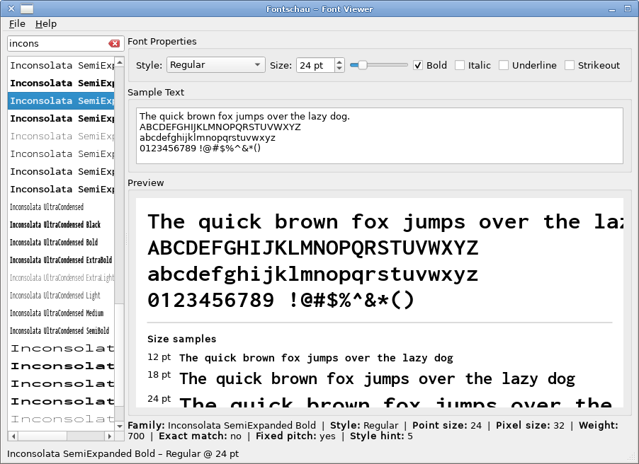

# Fontschau

A simple font viewer for Linux, written in C++ with Qt6.

Fontschau is a lightweight alternative to GNOME Font Viewer. It lets you browse the fonts installed on your system, preview them at different sizes and styles, and type your own sample text.



## Features

- Browse all installed font families
- Live search / filter
- Select available styles (Regular, Bold, Italic, …)
- Adjustable point size (spinbox + slider)
- Bold / Italic / Underline / Strikeout toggles
- Editable multi-line sample text
- Automatic multi-size pangram preview
- Basic font information (family, style, weight, exact match, …)
- Clean, straightforward Qt Widgets UI

## Building

### With Nix (recommended)

```bash
nix build
./result/bin/fontschau
```

Or enter a development shell:

```bash
nix develop
cmake -B build -DCMAKE_BUILD_TYPE=Release
cmake --build build
./build/fontschau
```

### With CMake + system Qt6

```bash
cmake -B build -DCMAKE_BUILD_TYPE=Release
cmake --build build
./build/fontschau
```

Requirements: Qt 6 (Widgets), CMake ≥ 3.16, C++17 compiler.

## License

GPL-3.0-or-later

## Authors

- Ingo Ruhnke <grumbel@gmail.com>
- Co-authored-by: Grok <grok@x.ai>
